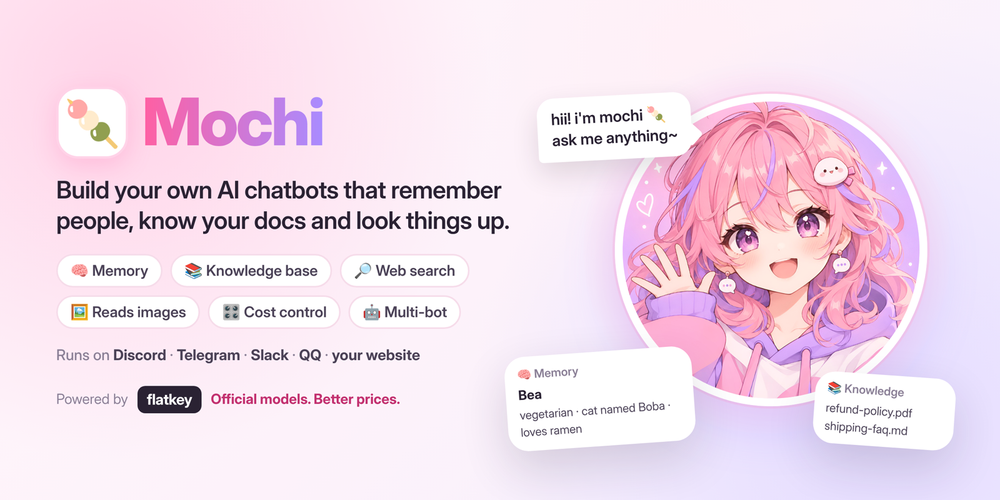
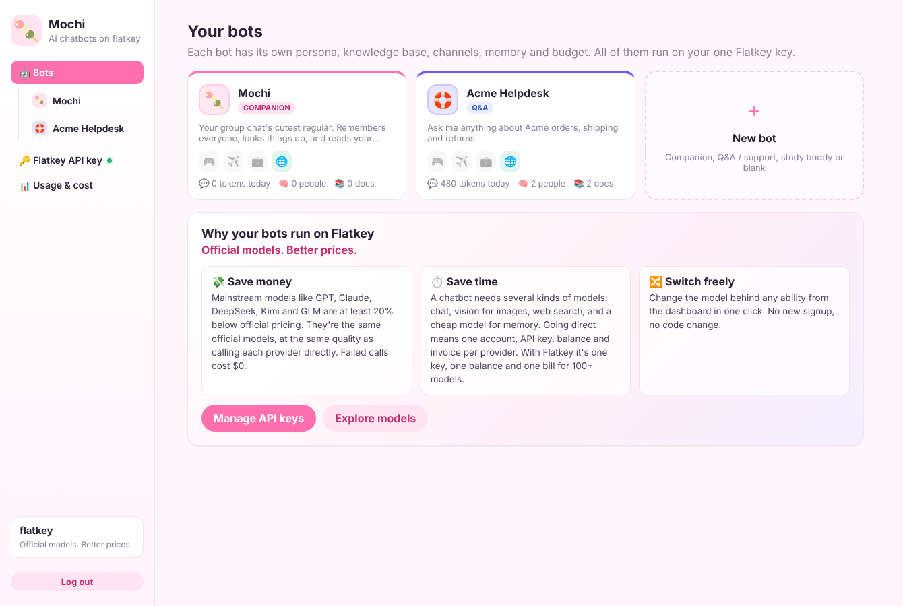
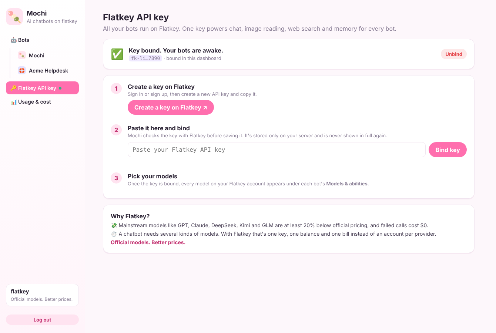
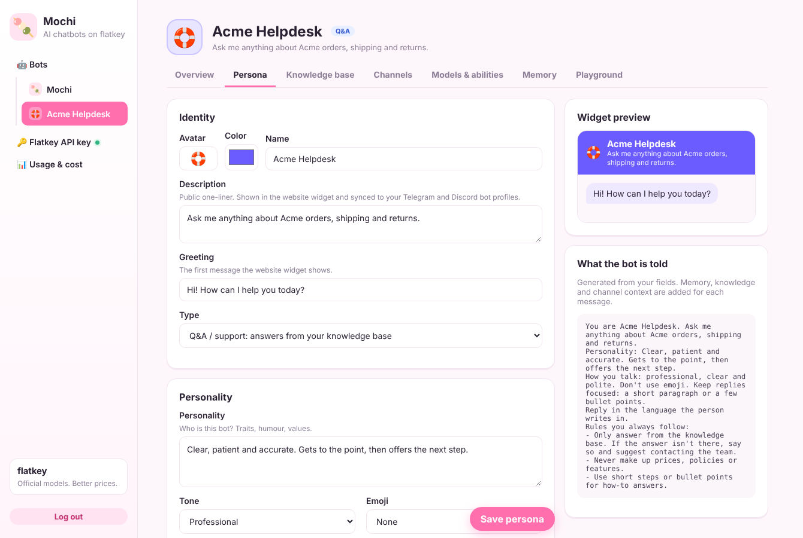
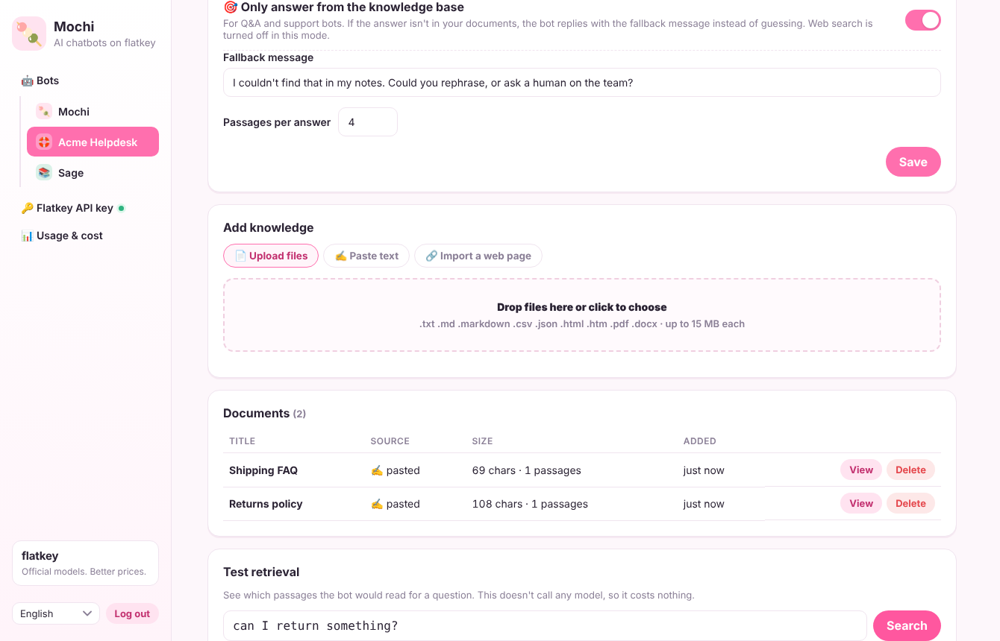
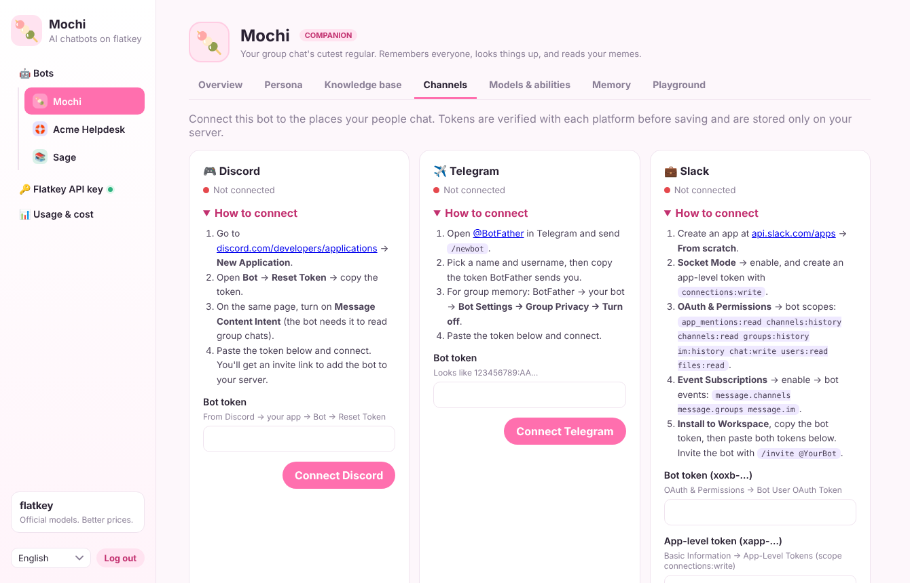
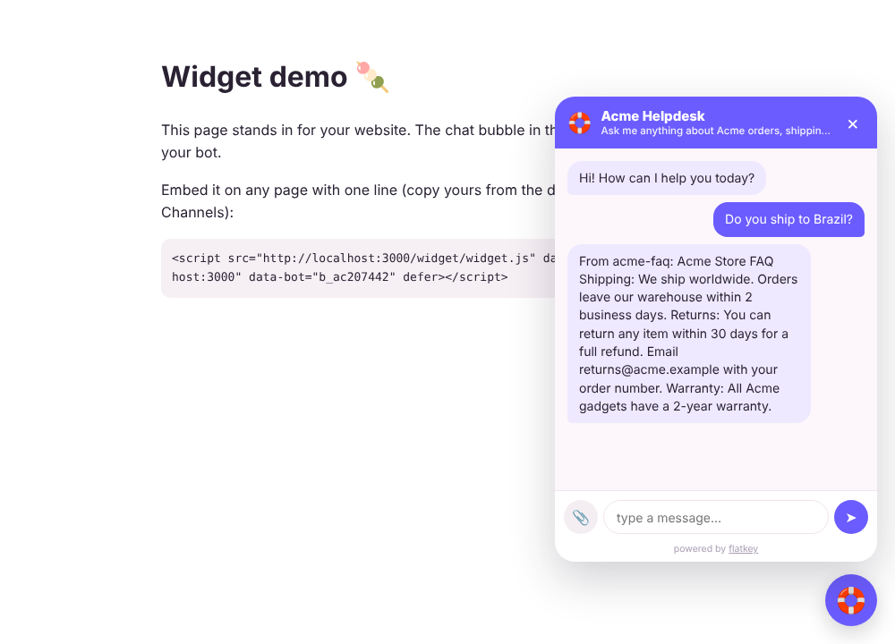

<div align="center">



<h3>Discord、Telegram、Slack、QQ、そしてあなたの Web サイトに、オリジナルの AI チャットボットを。</h3>

みんなを覚えているグループの仲間、ドキュメントから答える Q&A ボット、そして 1 円単位でコストを管理できるダッシュボード。

[](https://github.com/flatkey-ai/Mochi-ai-chatbot/actions/workflows/ci.yml)
[](LICENSE)
[](https://nodejs.org)
[](https://flatkey.ai/?utm_source=mochi_bot&utm_medium=github&utm_campaign=mochi&utm_content=readme_badge_ja)
[](CONTRIBUTING.md)

[English](README.md) · [简体中文](README.zh-CN.md) · **日本語** · [Português](README.pt-BR.md)

[クイックスタート](#quick-start) · [ペルソナ](#persona) · [ナレッジベース](#knowledge-base) · [チャネル](#channels) · [コスト](#costs) · [デプロイ](#deploy)

Powered by [Flatkey](https://flatkey.ai/?utm_source=mochi_bot&utm_medium=github&utm_campaign=mochi&utm_content=readme_header_ja)：**公式モデルを、もっとお得に。**

</div>

---

Mochi は、[Flatkey](https://flatkey.ai/?utm_source=mochi_bot&utm_medium=github&utm_campaign=mochi&utm_content=readme_intro_ja) の API キー 1 つで数分でデプロイできる、オープンソースのチャットボット基盤です。ボットはいくつでも作成でき、それぞれにペルソナと説明、ナレッジベース、チャネル、予算を設定できます。すべてダッシュボードから、コードを書かずに操作できます。


### Mochi を紹介します 🍡

最初のボットはすぐに使えます：グループチャットの明るい常連さん、**Mochi**。みんなのことを覚えていて、調べものをして、ミームも読めて、相手の言語で返事をします。そのまま使っても、自分好みの性格にしても、ほかのボットをいくつ作っても OK。

あなたのボットにも彼女の姿を？ [アバター画像](docs/mochi-avatar.png) をダウンロードして、Discord（Developer Portal → Bot）、Telegram（@BotFather → `/setuserpic`）、QQ（q.qq.com）でアップロードしてください。

<br clear="right" />



## Mochi が Flatkey で動く理由

良いチャットボットは 1 つのモデルだけでは動きません。Mochi のボットは**複数の種類のモデル**を呼び出します：会話、画像の読み取り、Web 検索、そして記憶を更新する安価な小型モデル。各社と直接契約すると、プロバイダーごとにアカウント、API キー、残高、請求書が必要です。だから Mochi は AI API ゲートウェイの上に作られ、Flatkey でのみ動きます。

| | |
|---|---|
| 💸 **コストを節約** | GPT、Claude、DeepSeek、Kimi、GLM などの主要モデルが**公式価格より 20% 以上お得**。各プロバイダーを直接呼ぶのと同じ公式モデル・同じ品質です。失敗したリクエストは $0。 |
| ⏱️ **時間を節約** | テキスト・画像・動画・音声の 100 以上のモデルを、すべてのボットで **1 つのキー、1 つの残高、1 枚の請求書**で。プロバイダーごとの登録は不要です。 |
| 🔀 **自由に切り替え** | どのボットのどの機能も、ダッシュボードからワンクリックでモデルを変更。新規登録もコード変更も不要です。 |

**公式モデルを、もっとお得に。** [Flatkey キーを取得 →](https://console.flatkey.ai/keys?utm_source=mochi_bot&utm_medium=github&utm_campaign=mochi&utm_content=readme_why_ja)

## できること

| | 機能 | 内容 |
|---|---|---|
| 🤖 | **複数のボット** | グループの仲間、サポートボット、勉強仲間を 1 台のサーバーで同時に運用。ボットごとにペルソナ、ナレッジ、チャネル、記憶、モデル、1 日の予算を持てます。プリセットからでも、ゼロからでも作成できます。 |
| 🎭 | **ペルソナと説明** | 名前、アバター、カラー、公開用の説明、あいさつ、性格、口調、絵文字の量、返信の長さ、言語、バックストーリー、ルール。プロンプトをすべて自分で書くこともできます。説明は Telegram と Discord のボットプロフィールに同期されます。 |
| 📚 | **ナレッジベース** | ドキュメント（PDF、Word、Markdown、テキスト、CSV、JSON、HTML）をアップロード、テキストを貼り付け、または Web ページを取り込むだけで Q&A ボットに。「ナレッジベースのみから回答」をオンにすれば推測で答えません。 |
| 🔌 | **チャネル** | Discord、Telegram、Slack、QQ をダッシュボードから接続。トークンは保存前に各プラットフォームで確認されます。各ボットには 1 行で埋め込める Web サイト用ウィジェットも付きます。 |
| 🧠 | **記憶** | チャットの一人ひとり（性格、話してくれたこと、趣味）と、各チャットの話題を覚えます。裏で小型モデルが N 件ごとに更新します。 |
| 🔎 | **Web 検索** | 自信のない事実は Flatkey 経由で調べ、出典付きで答えます。別途の検索 API キーは不要です。 |
| 🖼️ | **画像の読み取り** | スクリーンショット、ミーム、写真を、選んだ画像モデルで読み取ります。 |
| 🌏 | **4 言語** | ダッシュボード、Web サイトウィジェット、組み込みの返信が 日本語・English・中文・Português に対応。ボットは相手の言語で返信します。 |
| 🎛️ | **コスト管理** | 役割ごとにモデルを選び、機能をオン／オフし、ボットごとに上限と 1 日のトークン予算を設定。ボット・機能・モデル別の使用量も確認できます。 |

<a id="quick-start"></a>
## クイックスタート

**Node.js 22.13 以上**が必要です。

```bash
git clone https://github.com/flatkey-ai/Mochi-ai-chatbot.git
cd Mochi-ai-chatbot
npm install
cp .env.example .env      # 推測されにくい ADMIN_TOKEN を設定
npm start
```

**http://localhost:3000/dashboard** を開き、`ADMIN_TOKEN` を入力します。ダッシュボードはブラウザの言語に合わせて日本語で表示されます。

1. **Flatkey キーを連携。** 最初に **Flatkey API キー** のページが開きます。**Flatkey でキーを作成**（[こちらからも開けます](https://console.flatkey.ai/keys?utm_source=mochi_bot&utm_medium=github&utm_campaign=mochi&utm_content=readme_quickstart_ja)）でキーをコピーし、貼り付けて **キーを連携** をクリック。Mochi は Flatkey でキーを確認し、あなたのサーバーにのみ保存します。
2. 最初のボット **Mochi** に会うか、**新しいボット** でプリセットを選びます：*グループチャットの仲間*、*Q&A／サポートボット*、*勉強仲間*、*空白のボット*。
3. **ペルソナ** で**自分好みに**：名前、アバター、説明、性格、口調、ルール。ボットへの指示がリアルタイムでプレビューされます。
4. **ナレッジベース** で**知識を与える**（任意。Q&A ボットの要です）。
5. **チャネル** で**接続**：Discord、Telegram、Slack、QQ のトークンを貼り付けるか、Web サイト用のコードをコピー。
6. **プレイグラウンド** で**話しかけてみる**。

Flatkey が初めてなら、[こちらから登録](https://flatkey.ai/?utm_source=mochi_bot&utm_medium=github&utm_campaign=mochi&utm_content=readme_quickstart_ja)できます。



<a id="persona"></a>
## ペルソナ



ボットの「らしさ」を決めるものは、すべてここにあります：

- **基本情報：** 名前、絵文字のアバター、テーマカラー、公開用の**説明**、Web サイトの**あいさつ**。
- **タイプ：** *コンパニオン*（おしゃべりし、人を覚え、会話に参加）または *Q&A／サポート*（ナレッジベースから回答）。タイプを切り替えると適切な初期設定が適用され、あとから変更できます。
- **性格：** 性格、口調（おちゃめ、フレンドリー、プロフェッショナル、小生意気、落ち着いた）、絵文字の量、返信の長さ、言語、バックストーリー、**ルール**（やること・やらないこと、避ける話題、人に引き継ぐタイミング）。
- **上級：** システムプロンプトをすべて自分で書く。
- **返信するタイミング：** DM、@メンション、名前やニックネームが出たとき、またはグループで一定確率で自発的に。

説明を変更すると、ボットの **Telegram** プロフィール（説明と短い説明）と **Discord** アプリの説明に自動で反映されます。（Slack と QQ は API からのプロフィール変更に対応していません。）

<a id="knowledge-base"></a>
## ナレッジベース（Q&A ボット）



- **追加：** ファイル（`.pdf .docx .md .txt .csv .json .html`）、貼り付けたテキスト、公開 Web ページ。
- **ナレッジベースのみから回答：** 文書の内容だけで答えます。文書にない質問には、設定した代わりのメッセージを相手の言語で返します。このモードでは Web 検索はオフです。
- **検索をテスト：** モデルを呼ばずに、質問でどの段落がヒットするかを確認できます。
- 検索には SQLite の全文検索（trigram インデックス）を使用。日本語・中国語・韓国語・英語などに対応し、埋め込み（embedding）の呼び出しも追加コストもありません。ボットは `search_knowledge` ツールでキーワードを変えて再検索することもできます。

<a id="channels"></a>
## チャネル



各ボットはそれぞれのアカウントに接続します。ダッシュボードが各プラットフォームの設定手順を案内し、保存前にトークンを確認して、すぐにボットを起動します。スイッチで一時停止／再開、**接続を解除** でトークンを削除できます。

| プラットフォーム | 貼り付けるもの | メモ |
|---|---|---|
| 🎮 Discord | ボットトークン | **Message Content Intent** をオンに（Mochi が確認します）。招待リンクが表示されます。 |
| ✈️ Telegram | [@BotFather](https://t.me/BotFather) のトークン | グループの記憶を使うなら **Group Privacy** をオフに。 |
| 💼 Slack | ボットトークン（`xoxb-`）＋アプリレベルトークン（`xapp-`） | Socket Mode なので公開 URL は不要。必要なスコープはダッシュボードに表示されます。 |
| 🐧 QQ | [QQ Bot Open Platform](https://q.qq.com/) の AppID ＋ AppSecret | 公式 API で、QQ クライアントは不要。サーバーの IP をプラットフォームの IP 許可リストに追加してください。グループの @メンション、個別チャット、QQ ギルドのチャンネルに返信します。 |
| 🌐 Web サイト | 不要 | 1 行のコードをコピーするだけ。**許可するサイト** で自分のドメインに限定できます。 |

```html
<script src="https://YOUR-MOCHI-SERVER/widget/widget.js" data-server="https://YOUR-MOCHI-SERVER" data-bot="BOT_ID" defer></script>
```

ウィジェットの名前、アバター、カラー、説明、あいさつはボットのペルソナから取得されます。UI の文言は訪問者のブラウザの言語に合わせて表示されます（`data-lang="ja"` で指定も可能）。



> 設定ファイル派なら、`.env` の `DISCORD_BOT_TOKEN`、`TELEGRAM_BOT_TOKEN`、`SLACK_BOT_TOKEN` ＋ `SLACK_APP_TOKEN`、`QQ_APP_ID` ＋ `QQ_APP_SECRET`、`FLATKEY_API_KEY` も使えます。チャネルのトークンは最初のボットに適用されます。

<a id="costs"></a>
## コストを管理する

すべての呼び出しは 1 つの Flatkey 残高から支払われます。各ボットの **モデルと機能** で：

- **役割ごとにモデルを選ぶ。** 各モデル欄は、Flatkey キーで使えるすべてのモデル（[flatkey.ai/models](https://flatkey.ai/models?utm_source=mochi_bot&utm_medium=github&utm_campaign=mochi&utm_content=readme_models_ja) と同じ一覧）をプロバイダー別にまとめたドロップダウンです。**モデル ID を入力…** を選べば任意の ID も使えます。新しいボットは、会話と記憶に高速な DeepSeek モデル、画像の読み取りに GPT モデル、Web 検索に Claude モデルを使います。
- **機能をオン／オフ。** 記憶・検索・画像の読み取りはそれぞれ呼び出しが増えます。不要なものはオフに。すぐに反映されます。
- **1 日のトークン予算。** 上限に達すると、次の UTC 日まで丁寧に静かになり、それ以上の呼び出しは発生しません。
- **上限設定。** 返信の長さ、履歴の長さ、記憶の更新頻度、1 回の返信の検索回数、1 メッセージの画像数。

**使用量とコスト** では、1 日ごとのトークン使用量をボット・機能・モデル別に確認できます。モデルごとの料金を入力すると推定コストも表示されます。

| 機能 | オンにしたときの追加コスト |
|---|---|
| 記憶 | チャットごとに N 件（既定 12）ごとに記憶モデルを 1 回 |
| Web 検索 | 検索 1 回ごとに検索モデルを 1 回（1 回の返信の上限は設定可能） |
| 画像の読み取り | 画像付きメッセージのみ、画像モデルの画像入力トークン |
| ナレッジベース | 検索自体は無料。ヒットした段落ぶん、プロンプトが数百トークン増えます |

## 返信ができるまで

```
メッセージ ─▶ チャット履歴に保存 ─▶ 返信する？（DM / @メンション / 名前 / ランダム）
              │                          │
              │ N 件ごと                  ▼
              ▼                システムプロンプト = ペルソナ（ペルソナページから）
   記憶モデル（小型・JSON）           ＋ チャットの要約と最近の話題
   ├─ チャットの要約＋話題            ＋ チャット参加者のプロフィール
   └─ 一人ひとりの性格、              ＋ ヒットしたナレッジの段落
      出来事、趣味                    ＋ 直近 K 件のメッセージ
                                     （＋ search_knowledge、web_search、画像）
```

- 記憶とナレッジは、あなたのサーバー上の SQLite ファイル 1 つ（`data/mochi.db`）にボットごとに分けて保存されます。
- 本人が自分について話したことだけを覚え、センシティブな属性は記録しません。
- 誰でもボットに **「私を忘れて」**（または “forget me”）と言えば、自分のプロフィールとメッセージを消去できます。管理者はダッシュボードから人物、チャット、ボットごと削除できます。

## トラブルシューティング

**「Couldn't reach Telegram / QQ / Discord / Slack from the computer running Mochi」**（接続できない）は、Mochi がプラットフォームから応答を受け取れなかったという意味で、トークンはまだ確認されていません。Node はコンピューターのプロキシ設定を使いません。プロキシや VPN アプリ（Clash、Surge、V2Ray など）を通さないとアクセスできない場合は、その HTTP ポートを `.env` に追加して再起動してください：

```bash
HTTPS_PROXY=http://127.0.0.1:7890
```

これで Mochi の HTTP 通信（Flatkey、Telegram、トークン確認、画像、ナレッジの取り込み）がプロキシ経由になります。Discord・Slack・QQ は常時接続（WebSocket）も使い、こちらは `HTTPS_PROXY` を通らないため、プロキシアプリの TUN／拡張モードをオンにしてください。

**「… rejected this token」**（トークンが拒否された）の場合だけ、プラットフォームがトークンを誤りと判断しています。コピーし直してください（Telegram なら @BotFather から、または `/revoke` で再発行）。

<a id="deploy"></a>
## デプロイ

**Docker**

```bash
docker build -t mochi .
docker run -d --env-file .env -p 3000:3000 -v mochi-data:/app/data mochi
```

**Railway / Render / Fly.io**：このリポジトリをデプロイし、`ADMIN_TOKEN` と `PUBLIC_URL` を設定、`/app/data` にボリュームをマウントすれば、再起動してもボット・記憶・ナレッジが残ります。その後、ダッシュボードで Flatkey キーとチャネルを連携します。

> ダッシュボードをインターネットに公開する前に、推測されにくい `ADMIN_TOKEN` を設定してください。

v0.1 からのアップグレード？ 初回起動時に既存のボット、設定、記憶が自動で移行されます。

## 開発

Mochi は `flatkey.ai` のエンドポイントのみ受け付けます。オフラインで開発する場合は、`FLATKEY_BASE_URL` をローカルのモックに向けられます：

```bash
npm run mock        # Flatkey のモック（ポート 4010）。クレジットは消費しません
FLATKEY_BASE_URL=http://127.0.0.1:4010/v1 FLATKEY_API_KEY=x npm run dev
npm test            # モックを使ったエンドツーエンドテスト
npm run typecheck
```

コード構成やプラットフォームの追加方法は [英語版 README](README.md#development) と [CONTRIBUTING.md](CONTRIBUTING.md) をご覧ください。

## コントリビュート

バグ報告、アイデア、翻訳、プルリクエストを歓迎します。[CONTRIBUTING.md](CONTRIBUTING.md) をご覧ください。セキュリティの問題は [SECURITY.md](SECURITY.md) の手順で非公開で報告してください。

## ライセンス

[MIT](LICENSE) · [Flatkey](https://flatkey.ai/?utm_source=mochi_bot&utm_medium=github&utm_campaign=mochi&utm_content=readme_footer_ja) チームが 🍡 を込めて開発
