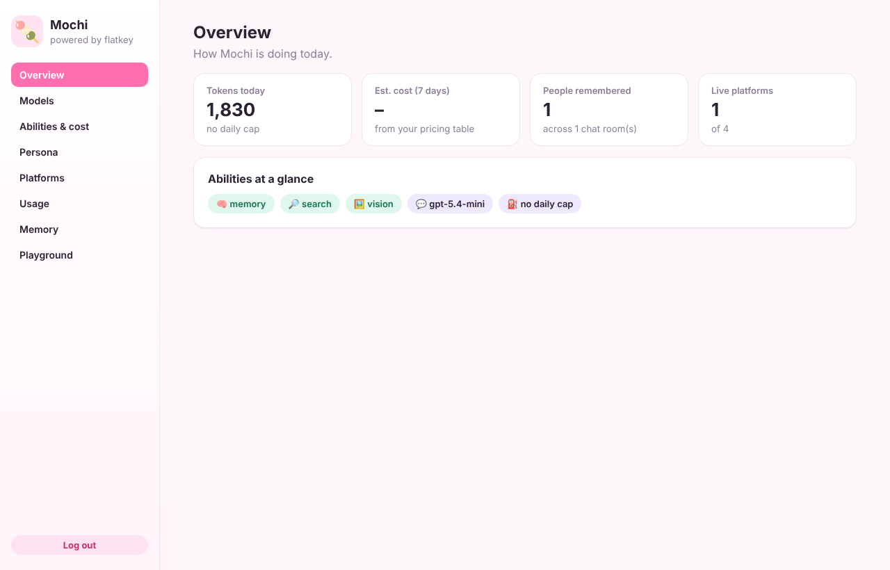
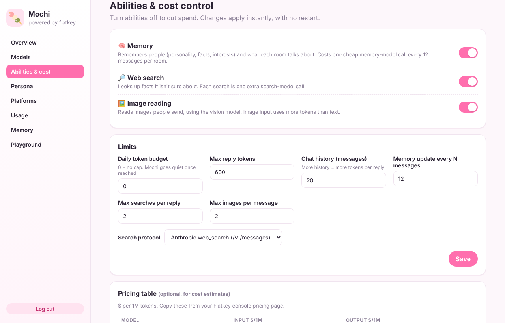
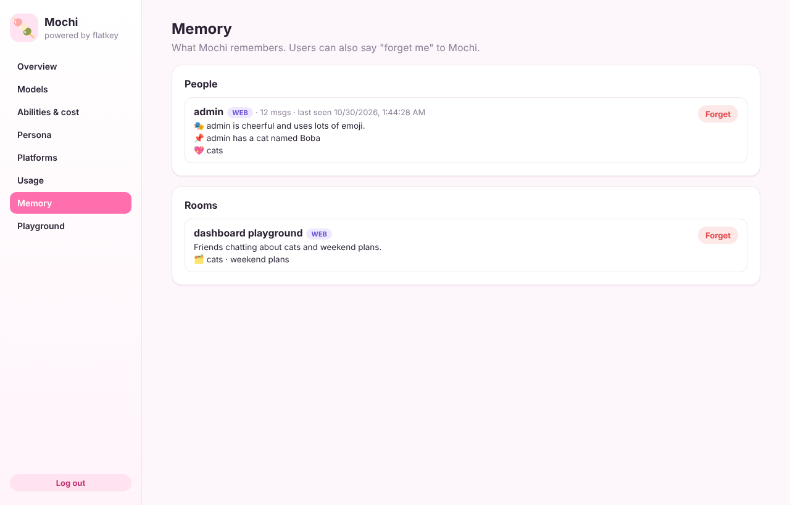

<div align="center">

# 🍡 Mochi

**Your own AI chat buddy for Discord, Telegram, Slack and your website.**
She remembers people, looks things up, reads images, and you control every cent she spends.

Powered by [Flatkey](https://flatkey.ai): **Official models. Better prices.**

</div>

---

Mochi is an open-source chatbot you can deploy in minutes with one [Flatkey](https://flatkey.ai) API key. Pick any model on Flatkey for each job (chat, vision, memory, search), switch abilities on or off from a dashboard, and set a daily budget so costs never surprise you.



## What she can do

| | Ability | How it works |
|---|---|---|
| 🧠 | **Memory** | Remembers each person in a chat room (personality, things they've shared, interests) and what each room has been talking about. A cheap background model updates memory every N messages, so the main chat model never re-reads long histories. |
| 💬 | **Chat** | Natural group-chat persona. Replies in DMs, when @mentioned, when her name comes up, or (optionally) chimes in at random. |
| 🔎 | **Web search** | When she isn't sure about a fact, she searches the live web through Flatkey and answers with sources. No separate search API key needed. |
| 🖼️ | **Image reading** | Reads images people send (screenshots, memes, photos) using a vision model you choose. |
| 🎛️ | **Dashboard** | Choose models from your Flatkey catalog, toggle abilities, set limits and a daily token budget, see usage per ability, browse and delete memory, and test her in a playground. |

## Quick start

You need **Node.js 22.13+** and a Flatkey API key from [console.flatkey.ai/keys](https://console.flatkey.ai/keys).

```bash
git clone https://github.com/flatkey-ai/Mochi-ai-chatbot.git
cd Mochi-ai-chatbot
npm install
cp .env.example .env      # add FLATKEY_API_KEY and an ADMIN_TOKEN
npm start
```

Open **http://localhost:3000/dashboard**, enter your `ADMIN_TOKEN`, and say hi in the **Playground**. Then connect the platforms you want:

<details>
<summary><b>🎮 Discord</b></summary>

1. Create an app at <https://discord.com/developers/applications> → **Bot** → copy the token into `DISCORD_BOT_TOKEN`.
2. On the same page, turn on **Message Content Intent**. Mochi needs it to read group chats for memory.
3. **OAuth2 → URL Generator**: scopes `bot`; permissions *Read Messages/View Channels*, *Send Messages*, *Read Message History*. Open the URL to invite her.
</details>

<details>
<summary><b>✈️ Telegram</b></summary>

1. Talk to [@BotFather](https://t.me/BotFather) → `/newbot` → copy the token into `TELEGRAM_BOT_TOKEN`.
2. For group memory: BotFather → your bot → **Bot Settings → Group Privacy → Turn off**.
3. Add the bot to a group. She replies when @mentioned, replied to, or called by name.
</details>

<details>
<summary><b>💼 Slack</b></summary>

1. Create an app at <https://api.slack.com/apps> → enable **Socket Mode** → create an app-level token with `connections:write` → `SLACK_APP_TOKEN` (`xapp-…`).
2. **OAuth & Permissions → Bot Token Scopes**: `app_mentions:read`, `channels:history`, `groups:history`, `im:history`, `chat:write`, `users:read`, `files:read`, `channels:read`.
3. **Event Subscriptions → Subscribe to bot events**: `message.channels`, `message.groups`, `message.im`.
4. Install to your workspace → copy the bot token into `SLACK_BOT_TOKEN` (`xoxb-…`). Invite her to channels with `/invite @Mochi`.
</details>

<details>
<summary><b>🌐 Website widget</b></summary>

Add one line before `</body>`:

```html
<script src="https://YOUR-MOCHI-SERVER/widget/widget.js" data-server="https://YOUR-MOCHI-SERVER" defer></script>
```

Optional attributes: `data-title`, `data-color="#ff6fae"`, `data-greeting`. Restrict which sites can embed it under **Dashboard → Platforms → Allowed origins**. Try it locally at `http://localhost:3000/widget/demo.html`.


</details>

Restart after adding tokens. After that, platforms can be switched on and off live from the dashboard.

## Control your costs



Everything goes through your Flatkey balance, and every lever is on the **Abilities & cost** page:

- **Pick a model per job.** Use a strong model for chat and a small one for background memory. Popular choices on Flatkey include GPT, Claude, DeepSeek, Kimi and GLM.
- **Toggle abilities.** Memory, search and vision each add calls; turn off what you don't need. Changes apply instantly.
- **Daily token budget.** Once it's reached, Mochi politely goes quiet until the next UTC day, with no further calls.
- **Limits.** Reply length, history length, memory update frequency, searches per reply, images per message.
- **Usage view.** Tokens per ability and model per day. Add per-model prices to see estimated cost.

| Ability | Extra cost when on |
|---|---|
| Memory | 1 memory-model call per room every N messages (default 12) |
| Search | 1 search-model call per search (max per reply is configurable) |
| Vision | Image input tokens on the vision model, only for messages with images |

## How memory works

```
message ─▶ stored in room history ─▶ reply? (DM / @mention / name / random)
                │                              │
                │ every N msgs                 ▼
                ▼                    system prompt = persona
   memory model (cheap, JSON)                 + room summary & recent topics
   ├─ room summary + recent topics            + profiles of people in the chat
   └─ per-person personality, facts,          + last K messages
      interests (only what they said)         (+ web_search tool, + images)
```

- Data lives in a single SQLite file (`data/mochi.db`) on your server.
- Only facts people share about themselves are kept. Sensitive traits are excluded by the memory prompt.
- Anyone can say **"forget me"** to Mochi to erase their profile and messages. Admins can delete people or rooms from **Dashboard → Memory**.



## How search works

Search is a tool the chat model can call. Mochi sends the query to Flatkey with the provider's native web-search tool:

- **Anthropic protocol** (default): `POST /v1/messages` with the `web_search` server tool, using a Claude model.
- **OpenAI protocol**: `POST /v1/responses` with the `web_search` tool, using a GPT model.

If one protocol fails, the other is tried. The grounded answer and its sources go back to the chat model, and links are appended to the reply.

## Deploy

**Docker**

```bash
docker build -t mochi .
docker run -d --env-file .env -p 3000:3000 -v mochi-data:/app/data mochi
```

**Railway / Render / Fly.io**: deploy the repo, set the variables from `.env.example`, and mount a volume at `/app/data` so memory survives restarts. Set `PUBLIC_URL` to your public URL so the widget snippet is correct.

> Set a strong `ADMIN_TOKEN` before exposing the dashboard to the internet.

## Development

```bash
npm run mock        # fake Flatkey router on :4010, no credits used
FLATKEY_BASE_URL=http://127.0.0.1:4010/v1 FLATKEY_API_KEY=x npm run dev
npm test            # end-to-end tests against the mock
npm run typecheck
```

```
src/
  core/        brain.ts (reply logic), settings.ts, types.ts
  flatkey/     client.ts (OpenAI-compatible + /messages + /responses)
  memory/      store.ts (SQLite), updater.ts (background memory pass)
  abilities/   search.ts
  adapters/    discord.ts, telegram.ts, slack.ts
  server/      app.ts (dashboard API + widget API)
public/
  dashboard/   no-build dashboard (HTML/CSS/JS)
  widget/      embeddable website widget
```

Adding a platform takes one adapter: convert incoming messages to `IncomingMessage`, call `brain.handle()`, and send back the reply.

## Why Flatkey?

Flatkey is built to be the most cost-efficient AI API gateway: one key and one balance for 100+ official models, at least 20% below official pricing, and failed calls cost $0. Mochi uses that one key for chat, vision, memory and search. [Get a key →](https://flatkey.ai)

## License

MIT
